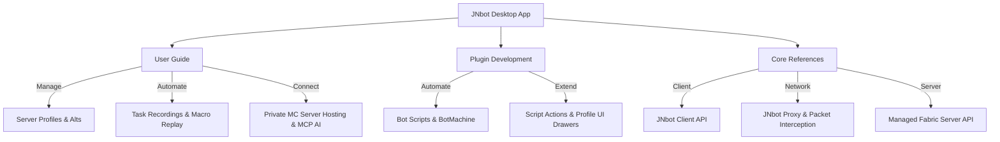

# JNbot documentation

Welcome to the JNbot documentation. JNbot is a desktop application and developer platform designed for Minecraft bot management, multi-account task automation, network proxying, and AI-assisted tooling.

---

## Documentation sections

### [User Guide](/docs/getting-started/first-steps)
Guides for setting up and operating the JNbot desktop application.
- **[First steps](/docs/getting-started/first-steps)**: Initial configuration, selecting server profiles, and connecting accounts.
- **[Managing accounts & alts](/docs/getting-started/alts)**: Adding Minecraft accounts, setting proxies, and tracking alt statistics.
- **[Server profiles](/docs/profiles/overview)**: Profile creation wizard, gamemodes, ranks, and server configurations.
- **[Task automation with recordings](/docs/plugins/recordings)**: Record in-game actions and replay them automatically.
- **[Minecraft servers](/docs/minecraft/overview)**: Host local Fabric servers or share worlds without router port forwarding.
- **[AI access with MCP](/docs/mcp)**: Connect AI tools and assistants via Model Context Protocol.
- **[Storage and backups](/docs/storage)**: Choose between local data, Dropbox sync, and cloud or file backups.
- **[Cooldowns](/docs/features/cooldowns)**: Track plugin cooldowns and optionally run a plugin when one is ready.
- **[Script chains](/docs/features/chains)**: Run a sequence of script actions for selected alts.

---

### [Plugin Development](/docs/plugins)
Guides and API documentation for scripting bots and writing extensions in JavaScript or TypeScript.
- **[Plugin overview](/docs/plugins)**: Getting started with JNbot plugin scripting.
- **[Bot API](/docs/plugins/code-based/bot)**: Connect bots, travel to gamemodes, interact with inventory GUIs, and handle trades.
- **[Script API & BotMachine](/docs/plugins/code-based/script)**: Runner controls, notifications, multi-alt iterators, and state machines.
- **[Local AI](/docs/plugins/code-based/local-ai)**: Use agents, structured extraction, embeddings, and custom models in plugins.
- **[Script actions](/docs/plugins/code-based/actions)**: Reusable action modules and trigger handlers.
- **[Profile UI plugins](/docs/plugins/profile-ui)**: Build rich interactive player drawer cards, badges, and stats panels.

---

### [Core References](/docs/jnbotclient/overview)
Detailed reference documentation for low-level packages and subsystem APIs.
- **[JNbot Client](/docs/jnbotclient/overview)**: Observe and control connected Minecraft clients with typed methods and events.
- **[JNbot Proxy](/docs/jnbotproxy)**: Route Minecraft traffic, intercept packets, and build network plugins.
- **[Managed Server API](/docs/minecraft/server-api)**: Inspect and manage local Fabric servers programmatically.
