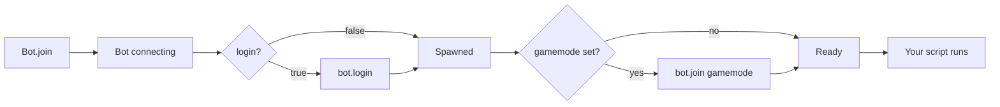

# Bot API

The `Bot` object is the main handle for controlling a Minecraft account from
a script. It handles login, gamemode navigation, inventory tooling and item
transfer for you, so a script can stay focused on what the bot should *do*.

:::tip
Every method on this page is available on the connected bot returned by
`bot.join(...)` / `Bot.join(...)`. The bot also emits a wide range of Minecraft
events (`spawn`, `chat`, `windowOpen`, `health`, …) that you can subscribe to
with `bot.on(event, handler)`.
:::

---

## Lifecycle



### Creating a bot

The `Bot` class is the entry point for creating a bot and connecting to the
server. Get it from the `JNbot` package — `require` in a JavaScript plugin,
`import` in a TypeScript plugin:

```js
// JavaScript plugin
const { Bot } = require("JNbot");
```

```ts
// TypeScript plugin
import { Bot } from "JNbot";
```

:::caution TypeScript plugins have no top-level `await`
TS plugins are compiled to CommonJS modules, which can't use top-level `await`.
Wrap awaiting code in an async function — `(async () => { … })()` — or use
`.then()`. JavaScript plugins keep top-level `await`.
:::

You create a `Bot` from a **profile** (the account / connection options like
`username`, `host`, `port`) and then `join` the server with a set of join
**options** (`gamemode`, `login`, …). There are two equivalent ways to do it:

```js
const { Bot } = require("JNbot");

// 1) Construct, then join.
const handle = new Bot({ username: "Zola" });
const bot = await handle.join({ gamemode: "skyblockdream", login: true });

// 2) Or do both in one call with the static helper.
const bot = await Bot.join(
  {
    username: "Zola",
    host: "jartex.fun",
    version: "1.8.9",
  },
  {
    login: true,                // log in with credentials from the alt list
    gamemode: "skyblockdream",  // join this gamemode after spawn
    stopOnEnd: false,           // stop the script when the bot disconnects
    onEnd: () => {},            // called when the bot disconnects
    onKick: (reason) => {},     // called when the bot is kicked
    proxy: {  url: "socks5://username:password@ip:port" } // optional proxy for the connection
  }
);
```

Both `handle.join(options)` and `Bot.join(profile, options)` resolve with the
same connected bot — everything else on this page operates on that bot.

---

## Authentication

### `bot.login(password?)`

Sends `/login <password>` to the server. If no password is given, it is pulled
from your alt list (or the user is prompted). Use this instead of writing the
password into the script so credentials never end up in the source.

```js
const bot = await Bot.join({ username: "Zola" });
await bot.login();          // uses the password from the alt list
await bot.login("hunter2"); // explicit
```

Or do everything in one call:

```js
const bot = await Bot.join({ username: "Zola" }, { login: true });
```

---

## Gamemode navigation

### `bot.join(gamemode, options?)`

Travels to a specific gamemode lobby. Works on every supported profile —
behind the scenes it uses the compass/command flow configured by the active
server profile.

```js
await bot.join("sbd");
// or
await bot.join("skyblockdream", {
  useCompass: false,   // navigate via the compass GUI
  command: "/server",  // command used when not using the compass
  timeout: 15000,
  allowError: false,   // throw if joining fails
  fastMode: false,     // resolve as soon as a teleport packet arrives
});
```


---

## Player info

| Method                       | Description                                                    |
| ---------------------------- | -------------------------------------------------------------- |
| `bot.getWindowTitle(win?)`   | Plain-text title of the open window. Falls back to `currentWindow`. |
| `bot.isOnline()`             | `true` while the underlying socket is still alive.             |
| `bot.mainVersion`            | The major Minecraft version as a number (e.g. `1.8.9` → `8`). |


---

## Window / GUI

### `bot.openWindow(command, options?)`

Sends a command and waits for the resulting window to open. Returns the window
object, or `null` if it times out.

```js
const win = await bot.openWindow("/server");

// retry the command every 3s, until the title matches
const gkitsWin = await bot.openWindow("/gkit", {
  timeout: 15_000,
  commandInverval: 3_000,
  check: (window) => window.title.includes("gkits"),
  ticks: 20,
});
```

### `bot.getWindowTitle(win?)`

Plain-text version of a window's title (handles NBT-formatted titles).

### `bot.findWindowSlots(filter, options?)`

Search the open window for items matching a name and/or lore filter. Returns
an array of slot objects.

```js
// Single string filter — searches item name
const diamonds = bot.findWindowSlots("diamond");

// Object filter — name AND lore
const items = bot.findWindowSlots(
  { name: "key", lore: "rare" },
  { caseSensitive: false }
);

// Restrict the search to specific rows or columns
const topRow = bot.findWindowSlots("shard", { rows: [0] });
const leftCol = bot.findWindowSlots("rune", { columns: [0] });

// Or an explicit slot range
const partial = bot.findWindowSlots("ingot", { slotRange: [10, 11, 12, 19, 20, 21] });
```

| Option          | Type              | Description                                                                 |
| --------------- | ----------------- | --------------------------------------------------------------------------- |
| `caseSensitive` | boolean           | Default `false`. Match the filter exactly.                                  |
| `rows`          | `number[]`        | Restrict the search to these rows (each row = 9 slots).                     |
| `columns`       | `number[]`        | Restrict to these columns (0–8).                                            |
| `slotRange`     | `number[]`        | Explicit list of slot indexes to search.                                    |
| `window`        | `Inventory`       | Search a different window instead of `bot.currentWindow`.                   |
| `toAlpha`       | boolean           | Normalize small-caps unicode letters before matching (`ʀᴀʀᴇ` → `rare`).      |

The `filter` can be:

- a string (matches against the item name), or
- an object with `name` and/or `lore` fields.

### `bot.openInventory()`

On some anti-cheats you have to "open" your inventory before the server
accepts slot clicks. This sends the packet the vanilla client sends when you
press `E`.

```js
bot.openInventory();
bot.clickWindow(10, 0, 0);
bot.clickWindow(12, 0, 0);
```

---

## Inventory utilities

| Method                       | Description                                                    |
| ---------------------------- | -------------------------------------------------------------- |
| `bot.itemInfo(slot)`         | Parsed `{ name, info }` for the item (lore is concatenated).   |
| `bot.hasFullInventory()`     | `true` if every slot in the main inventory is occupied.        |
| `bot.countInventoryItems()`  | Number of non-clock items currently in the main inventory.     |

```js
bot.itemInfo(bot.inventory.slots[36]); // { name: "...", info: "..." }
if (bot.hasFullInventory()) bot.chat("/trash");
```

---

## Item transfer

`bot.transferItems` bundles the helpers for moving items in and out of trade
windows. Every method is asynchronous and resolves when the transfer
finishes (or rejects on timeout).

### Trade with another player

```js
await bot.transferItems.trade({ username: "Zola" });
```

### Gift to another player

```js
await bot.transferItems.gift({ username: "Zola" });
```

### Filter what gets moved

```js
// only diamonds and dirt
await bot.transferItems.trade({ username: "Zola", filter: [1, "dirt"] });

// ignore wool & keep a specific item
await bot.transferItems.gift(2, {
  username: "Zola",
  ignore: [35],
  itemFilter: (item) => item.name !== "diamond_sword",
});
```

### Transfer into a server window

```js
await bot.transferItems.window(3, {
  filter: [1, "dirt"],
  command: "/trash",
});
```

### Trade with key counts

```js
await bot.transferItems.tradeWithKeys({
  username: "Zola",
  keys: ["vote,10", "rare,5", "ultra,2", "god,1"],
});
```

### Trash items

```js
await bot.transferItems.trash({ ignore: ["diamond_block"] });
```

---

## Pathfinding

Pathfinding is available as an opt-in plugin. Load it once after the bot is
created, then drive it from your `spawn` handler.

```js
const { Bot } = require("JNbot");
const pathfinder = require("mineflayer-pathfinder").pathfinder;
const Movements = require("mineflayer-pathfinder").Movements;
const { GoalNear } = require("mineflayer-pathfinder").goals;

const bot = await Bot.join({ username: "Zola" });
bot.loadPlugin(pathfinder);

bot.once("spawn", () => {
  bot.pathfinder.setMovements(new Movements(bot));
  bot.pathfinder.setGoal(new GoalNear(10, 90, 10, 1));
});
```

---

## Utilities

### `bot.onceWithTimeout(event, timeoutInTicks)`

Like `bot.once(event, ...)` but resolves anyway after the timeout. Useful when
the event might never fire.

```js
// wait up to 1 second (20 ticks) for the next spawn
await bot.onceWithTimeout("spawn", 20);
```

### `bot.hasFullInventory()` / `bot.countInventoryItems()`

See [Inventory utilities](#inventory-utilities).
