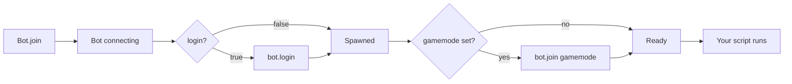

# Bot API

The `Bot` object is the main handle for controlling a Minecraft account from
a script. It handles login, gamemode navigation, inventory tooling and item
transfer for you, so a script can stay focused on what the bot should *do*.

:::tip
Every method on this page is available on the connected bot returned by
`bot.join(...)` / `Bot.join(...)`. The bot also emits a wide range of Minecraft
events (`spawn`, `chat`, `windowOpen`, `health`, …) that you can subscribe to
with `bot.on(event, handler)`.
:::

---

## Lifecycle



### Creating a bot

The `Bot` class is the entry point for creating a bot and connecting to the
server. Get it from the `JNbot` package — `require` in a JavaScript plugin,
`import` in a TypeScript plugin:

```js
// JavaScript plugin
const { Bot } = require("JNbot");
```

```ts
// TypeScript plugin
import { Bot } from "JNbot";
```

:::caution TypeScript plugins have no top-level `await`
TS plugins are compiled to CommonJS modules, which can't use top-level `await`.
Wrap awaiting code in an async function — `(async () => { … })()` — or use
`.then()`. JavaScript plugins keep top-level `await`.
:::

You create a `Bot` from a **profile** (the account / connection options like
`username`, `host`, `port`) and then `join` the server with a set of join
**options** (`gamemode`, `login`, …). There are two equivalent ways to do it:

```js
const { Bot } = require("JNbot");

// 1) Construct, then join.
const handle = new Bot({ username: "Zola" });
const bot = await handle.join({ gamemode: "skyblockdream", login: true });

// 2) Or do both in one call with the static helper.
const bot = await Bot.join(
  {
    username: "Zola",
    host: "jartex.fun",
    version: "1.8.9",
  },
  {
    login: true,                // log in with credentials from the alt list
    gamemode: "skyblockdream",  // join this gamemode after spawn
    stopOnEnd: false,           // stop the script when the bot disconnects
    onEnd: () => {},            // called when the bot disconnects
    onKick: (reason) => {},     // called when the bot is kicked
    proxy: {  url: "socks5://username:password@ip:port" } // optional proxy for the connection
  }
);
```

Both `handle.join(options)` and `Bot.join(profile, options)` resolve with the
same connected bot — everything else on this page operates on that bot.

---

## Authentication

### `bot.login(password?)`

Sends `/login <password>` to the server. If no password is given, it is pulled
from your alt list (or the user is prompted). Use this instead of writing the
password into the script so credentials never end up in the source.

```js
const bot = await Bot.join({ username: "Zola" });
await bot.login();          // uses the password from the alt list
await bot.login("hunter2"); // explicit
```

Or do everything in one call:

```js
const bot = await Bot.join({ username: "Zola" }, { login: true });
```

---

## Gamemode navigation

### `bot.join(gamemode, options?)`

Travels to a specific gamemode lobby. Works on every supported profile —
behind the scenes it uses the compass/command flow configured by the active
server profile.

```js
await bot.join("sbd");
// or
await bot.join("skyblockdream", {
  useCompass: false,   // navigate via the compass GUI
  command: "/server",  // command used when not using the compass
  timeout: 15000,
  allowError: false,   // throw if joining fails
  fastMode: false,     // resolve as soon as a teleport packet arrives
});
```


---

## Player info

| Method                       | Description                                                    |
| ---------------------------- | -------------------------------------------------------------- |
| `bot.getWindowTitle(win?)`   | Plain-text title of the open window. Falls back to `currentWindow`. |
| `bot.isOnline()`             | `true` while the underlying socket is still alive.             |
| `bot.mainVersion`            | The major Minecraft version as a number (e.g. `1.8.9` → `8`). |


---

## Window / GUI

### `bot.openWindow(command, options?)`

Sends a command and waits for the resulting window to open. Returns the window
object, or `null` if it times out.

```js
const win = await bot.openWindow("/server");

// retry the command every 3s, until the title matches
const gkitsWin = await bot.openWindow("/gkit", {
  timeout: 15_000,
  commandInverval: 3_000,
  check: (window) => window.title.includes("gkits"),
  ticks: 20,
});
```

### `bot.getWindowTitle(win?)`

Plain-text version of a window's title (handles NBT-formatted titles).

### `bot.items(query?)`

Find items in the open window and/or your inventory, whether or not a window
is open. A string matches as a **case-insensitive substring** of the item's
name, after stripping `§` color codes and small caps, so `"kit"` matches
`§6ᴋɪᴛ Warrior`. Items that aren't renamed match on their vanilla name, so
`"golden apple"` finds a plain golden apple. Results are plain items (with `.slot`), so they work with
`bot.clickWindow`.

```js
// First item whose name contains "kit": open window first, then inventory
const kit = bot.items("kit").first();

// A list matches any entry: "Starters Kit", "Confirmation of trade", ...
const button = bot.items(["kit", "confirm"]).first();

// Name AND lore, only in the top part of the open window
await bot.items({ name: "key", lore: "rare" }).container().click();

// Item id, regex or any predicate
const diamonds = bot.items({ type: "diamond" }).inventory().count();
const priced = bot.items({ lore: /price: \d+/i }).all();
const stacks = bot.items((item) => item.count === 64).all();

// Restrict to rows, columns or exact slots
bot.items("shard").rows(0).all();
bot.items("rune").cols(0).all();
bot.items("ingot").slots(10, 11, 12).all();

// Wait until an item shows up (also in a window that opens later)
const confirm = await bot.items("Confirm").wait(40); // null after 40 ticks

// Lazy iteration: scanning stops when you break
for (const item of bot.items("rune")) { /* ... */ }
```

**Query** (all given fields must match)

| Field           | Type                                    | Description                                              |
| --------------- | --------------------------------------- | -------------------------------------------------------- |
| `name`          | string, RegExp, `(text) => boolean` or an array of these | Custom name. A plain string or array is shorthand for `{ name }`. |
| `lore`          | same as `name`                          | Lore, lines joined with `\n`.                            |
| `type`          | string or `string[]`                    | Minecraft item id, e.g. `"diamond_sword"`.               |
| `where`         | `(item) => boolean`                     | Any extra check. A function is shorthand for `{ where }`. |
| `caseSensitive` | boolean                                 | Default `false`. Colors are stripped either way.         |

An array matches when **any** entry matches. RegExps and functions get the color-stripped text with its case kept.

**Scope** (chainable, default `any`)

| Method                          | Searches                                                                   |
| ------------------------------- | -------------------------------------------------------------------------- |
| `.any()`                        | Container slots, then the player inventory (only the inventory without a window). |
| `.container()`                  | Only the top part of the open window.                                      |
| `.inventory()`                  | Only the player inventory, with or without an open window.                 |
| `.hotbar()`                     | Only the 9 hotbar slots.                                                   |
| `.rows(...rows)`, `.cols(...c)` | Container rows (9 slots each) / columns (0–8). Combined: slots in both.    |
| `.slots(...indexes)`            | Exact window slot indexes.                                                 |

**Results**

| Method                    | Returns                                                       |
| ------------------------- | ------------------------------------------------------------- |
| `.first()`                | First match or `null`.                                        |
| `.all()`                  | Array of all matches.                                         |
| `.has()`                  | `true` if anything matches.                                   |
| `.count()`                | Sum of `item.count` over all matches.                         |
| `.click(button?, mode?)`  | Clicks the first match; resolves with it, or `null`.          |
| `.wait(ticks = 100)`      | Resolves with the first match once it appears, or `null`.     |

`bot.cleanText(text)` applies the same normalization (strip colors and small
caps, lowercase) for your own matching, e.g. on chat or scoreboard text.

### `bot.findWindowSlots(filter, options?)` (deprecated)

Use `bot.items(query)` instead; `bot.findWindowSlots("diamond")` becomes
`bot.items("diamond").container().all()`. It still works for existing plugins.

### `bot.openInventory()`

On some anti-cheats you have to "open" your inventory before the server
accepts slot clicks. This sends the packet the vanilla client sends when you
press `E`.

```js
bot.openInventory();
bot.clickWindow(10, 0, 0);
bot.clickWindow(12, 0, 0);
```

---

## Inventory utilities

| Method                       | Description                                                    |
| ---------------------------- | -------------------------------------------------------------- |
| `bot.itemInfo(slot)`         | Parsed `{ name, info }` for the item (lore is concatenated).   |
| `bot.itemInfo.name(slot)`    | Only the item's name (skips parsing the lore).                 |
| `bot.itemInfo.lore(slot)`    | Only the item's lore, lines joined with `\n`.                  |
| `bot.hasFullInventory()`     | `true` if every slot in the main inventory is occupied.        |
| `bot.countInventoryItems()`  | Number of non-clock items currently in the main inventory.     |

```js
bot.itemInfo(bot.inventory.slots[36]); // { name: "...", info: "..." }
if (bot.hasFullInventory()) bot.chat("/trash");
```

---

## Item transfer

`bot.transfer(mode, target?, options?)` moves inventory items away. Pick a
mode, give its target (a username for `trade`/`gift`, a command for
`window`) and optionally choose which items go. It resolves with what left
the inventory:

```js
const result = await bot.transfer("gift", "Zola");
// { completed: true, count: 70, items: [{ name: "diamond", displayName: "Diamond", count: 64 }, ...] }
```

`completed` is `false` when the transfer hit its `timeout`.

| Mode     | Target      | What it does                                |
| -------- | ----------- | ------------------------------------------- |
| `trade`  | username    | Trades the items to a player                |
| `gift`   | username    | Gifts the items to a player                 |
| `window` | command     | Moves the items into a window, e.g. `/ec`   |
| `trash`  | none        | Deletes the items via the trash menu        |
| `keep`   | none        | Does nothing (useful for a mode setting)    |

```js
await bot.transfer("gift", "Zola");          // gift every item
await bot.transfer("window", "/ec");         // fill the ender chest
await bot.transfer("trash");                 // trash everything
await bot.transfer.trade("Zola");            // shorthand per mode
```

When `trade`/`gift` gets no username, the user is asked for one.

### Choose which items

`items` (what to send) and `exclude` (what to keep) take the same filters as
[`bot.items`](#botitemsquery): a name, a list of names, `{ type, name, lore,
where }` or a function. Mix several in a list to match any of them, e.g.
`["kit", { type: "clock" }, (item) => item.count < 5]`.

```js
await bot.transfer("trade", "Zola", { items: { type: ["diamond", "emerald"] } });
await bot.transfer("trash", { exclude: ["kit", { type: "clock" }] });
await bot.transfer("gift", "Zola", { items: { lore: "rare" }, exclude: "soulbound" });
```

Or start from a `bot.items` query; it transfers the matching inventory items:

```js
await bot.items({ type: "diamond" }).transfer("trade", "Zola");
await bot.items("kit").transfer("trash");
```

### Send crate keys

`trade` and `gift` can send virtual crate keys along. They are sent even when
there are no items to transfer, unless you pass `keysWithoutItems: false`.
Gifts add them through the gift window's
"Send Crate Keys" page; when a key or the key page is missing, the bot logs a
warning and sends without it.

```js
await bot.transfer("gift", "Zola", {
  keys: [
    { keyName: "vote", amount: 3 },
    { keyName: "rare", amount: 1 },
  ],
});
```

### Other options

- `timeout`: give up after this many ms (`completed: false`).
- `shiftClick` (`window`, default `true`): set to `false` for servers that
  block shift-clicking into their window.

### Custom modes

Add a mode for this bot with `bot.transfer.addMode(name, { target, keys,
tasks })`, e.g. from the server's bot extension. `tasks` are
[BotMachine](./script.md#botmachine) tasks (or a function returning them) and must call
`machine.finish()` when done. Their `state` holds:

- `state.items`: a live `bot.items` query of the items to transfer
- the target under its name (`state.price` below)
- `state.options`: every option passed, including your own
- `state.keys`: the keys to send, when the mode sets `keys: true`

Adding a mode with a built-in name replaces it for this bot.

```js
bot.transfer.addMode("auction", {
  target: "price",
  tasks: [
    { name: "Done", when: ({ state }) => !state.items.has(), run: ({ machine }) => machine.finish() },
    {
      name: "Listing item",
      when: () => true,
      run: async ({ bot, state }) => {
        await bot.equip(state.items.first(), "hand");
        bot.chat(`/ah sell ${state.price}`);
        await bot.waitForTicks(20);
      },
    },
  ],
});

await bot.items("diamond").transfer("auction", 500);
await bot.transfer.auction(500); // every mode gets a shortcut
```

### `bot.transferItems` (deprecated)

The old `bot.transferItems(mode, { username, filter, ignore, keep, sendKeys,
keys: ["vote,10"] })` still works but is deprecated; use `bot.transfer`.

### Server-specific transfer config

Commands, window titles and buttons differ per server and change often. Each
bot has its own `bot.transfer.config`; adjust it from the server's bot
extension with `configure`, which deep-merges your overrides into the
defaults. Only list what differs.

```js
function main(bot) {
  bot.transfer.configure({
    trade: { command: "/trade {username}", acceptButton: "glass" },
    gift: {
      command: "/gift {username}",
      confirmWindowTitle: ["are you sure", "confirm gift"],
      confirmButton: ["green_terracotta", "confirm"],
      depositWindowTitle: ["select items to send", "send items"],
      keysOwnedLore: /keys owned:\s*(\d+)/i, // first group = number of keys
    },
    trash: { command: "/trash", windowTitle: ["trash", "disposal"] },
  });
}
```

- Strings match case-insensitively with color codes stripped, and may use
  `{username}`. RegExps are tested on the text with color codes stripped, so
  add the `i` flag to ignore case.
- A title or button can be a list (any entry matches), a string, a RegExp or a function,
  so one config keeps working while a server rolls out a renamed window.
  Buttons are matched against the item id, display name and lore, e.g.
  `(item) => item.name === "lime_dye"`.
- Fallback slots (`trade.acceptSlot`, `gift.confirmSlot`, ...) are used when a
  button can't be found.
- `bot.transfer.resetConfig()` restores the defaults.

See `TransferConfig` in the plugin types for every option.

---

## Pathfinding

Pathfinding is available as an opt-in plugin. Load it once after the bot is
created, then drive it from your `spawn` handler.

```js
const { Bot } = require("JNbot");
const pathfinder = require("mineflayer-pathfinder").pathfinder;
const Movements = require("mineflayer-pathfinder").Movements;
const { GoalNear } = require("mineflayer-pathfinder").goals;

const bot = await Bot.join({ username: "Zola" });
bot.loadPlugin(pathfinder);

bot.once("spawn", () => {
  bot.pathfinder.setMovements(new Movements(bot));
  bot.pathfinder.setGoal(new GoalNear(10, 90, 10, 1));
});
```

---

## Utilities

### `bot.onceWithTimeout(event, timeoutInTicks)`

Like `bot.once(event, ...)` but resolves anyway after the timeout. Useful when
the event might never fire.

```js
// wait up to 1 second (20 ticks) for the next spawn
await bot.onceWithTimeout("spawn", 20);
```

### `bot.hasFullInventory()` / `bot.countInventoryItems()`

See [Inventory utilities](#inventory-utilities).
