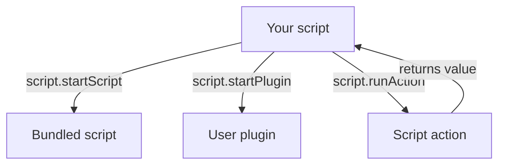

# Script API

The `script` object is your interface with the host app for spawning bots,
prompting the user, talking to the console, running other scripts, and
reading the alt list. Use [`script.ai`](./local-ai.md) for local AI tool calls,
structured extraction, and embeddings.

## The `JNbot` package

The jnbot-specific helpers live in the `JNbot` package. Pull in what you need.
`require` in a JavaScript plugin, `import` in a TypeScript plugin:

```js
// JavaScript plugin
const { Bot, BotMachine, ProxyServer, ProxyPlugin, script } = require("JNbot");
```

```ts
// TypeScript plugin
import { Bot, BotMachine, ProxyServer, ProxyPlugin, script } from "JNbot";
```

:::caution JavaScript vs TypeScript
Use `import` only in **TypeScript** plugins — they're compiled to CommonJS, so
the `import` becomes a `require` for you. The flip side: a TS plugin can't use
top-level `await` (wrap awaiting code in `(async () => { … })()` or use
`.then()`). **JavaScript** plugins use `require` and keep top-level `await`.
:::

| Export        | What it is                                                                       |
| ------------- | ------------------------------------------------------------------------------- |
| `Bot`         | Create a bot and join a server. See [Bot API](./bot.md#creating-a-bot).          |
| `BotMachine`  | Drive a bot with a prioritised task list. See [`BotMachine`](#botmachine).       |
| `ProxyServer` | Start a JNbot proxy. See [JNbot Proxy](../../jnbotproxy/index.md). |
| `ProxyPlugin` | Base class for proxy plugins with `/jnbot` commands. See [Plugins](../../jnbotproxy/pluginmanager.md). |
| `ProxySession`, `ProxyParticipant`, `PluginManager`, `PacketPipeline`, `PacketContext` | Proxy classes, exported for type checks and `instanceof`. |
| `ANY_PACKET`, `PacketGroups` | Packet name helpers. See [Packet interception](../../jnbotproxy/packetmanager.md). |
| `DebugPlugin`, `RECORDINGS_PATH` | Packet debug recordings. See [Debug recordings](../../jnbotproxy/recorder.md). |
| `script`      | The host-app API documented on this page.                                        |

## Globals

These objects are always in scope — no import needed:

| Global             | What it is                                                                                  |
| ------------------ | ------------------------------------------------------------------------------------------- |
| `console`          | Logging helpers that route into the script's own console panel.                             |
| `setTimeout` / `setInterval` / `clearTimeout` / `clearInterval` / `setImmediate` / `clearImmediate` | Standard Node timer functions. |

:::caution Deprecated globals
For backwards compatibility, `script`, `join`, `BotMachine`, and the legacy
`Statemachine` / `BotStatemachine` are still exposed as globals. Import from
the `JNbot` package instead, and use the `Bot` class in place of `join`.
:::

You can also `require()` a small allow-list of modules:

```js
const { Bot, BotMachine } = require("JNbot");
const axios = require("axios");
const { Vec3 } = require("vec3");
const events = require("events");
const assert = require("assert");
const { goals } = require("mineflayer-pathfinder");
const nbt = require("prismarine-nbt");
```

:::info Allowed modules
`JNbot` (alias `jnbot`), `events`, `axios`, `mineflayer-pathfinder`, `vec3`,
`assert`, the prismarine helpers (`prismarine-item`, `prismarine-entity`,
`prismarine-block`, `prismarine-world`, `prismarine-chunk`, `prismarine-chat`,
`prismarine-nbt`, `prismarine-windows`), `nbt` (alias of `prismarine-nbt`),
`jnbotNbt` (JNbot's NBT parser).
Any other module will throw — open an issue if you need one added.
:::

---

## Lifecycle

### `script.stop()`

Stops the currently running script.

```js
script.stop();
```

### `script.restart()`

Restarts the currently running script.

```js
script.restart();
```

### `script.onExit(handler)`

Register a handler invoked when this script is about to end — fired when the
app stops the script (stop button, app close, restart). You get a short grace
window (~100&nbsp;ms) for cleanup before the worker is killed, so keep the
handler quick and avoid long-running async work. Returns a function that
removes the listener.

```js
const off = script.onExit(() => {
  console.log("cleaning up before exit");
});

// later, to stop listening:
off();
```

### `script.scriptInfo`

A read-only descriptor of the running plugin. Useful for tagging logs or
namespacing storage.

```js
console.log(script.scriptInfo.name);     // "My plugin"
console.log(script.scriptInfo.pluginId); // "mcj8ivyli95uois8vt"
```

### `script.settings`

The settings object configured for this plugin. Whatever you set up in the
plugin's settings UI is exposed here as a plain object.

```js
const delay = script.settings.delay ?? 1000;
await sleep(delay);
```

### `script.JNdata`

Read-only JNbot data for the active server. `gamemodes` maps each gamemode to
its known `ranks` and `gkits`.

```js
const sbd = script.JNdata.gamemodes.skyblockdream;
console.log(sbd?.ranks); // { SkyGod: { price, color }, ... }
console.log(sbd?.gkits); // { spider: 604800, ... }
```

### `script.startAction({ actionId, bot?, optionOverrides?, args })`

Run a JavaScript script-action by ID and await the value returned by its
`main` function. The action receives `(bot, settings, args)`, where `settings`
contains the action's resolved options with `optionOverrides` applied and
`args` is the array supplied by the caller.

```js
const result = await script.startAction({
  actionId: "my-action-id",
  bot,
  optionOverrides: { gamemode: "skyblockdream" },
  args: ["hello", 42],
});
```

Use `script.runAction(name, bot, ...args)` for the existing name-based form;
see [Actions](./actions.md) for both calling conventions.

---

## Running other scripts and plugins



### `script.startScript({ name, quitOnExit? })`

:::warning Deprecated
`startScript` / `stopScript` are deprecated — use `script.startPlugin()` /
`script.stopPlugin()` instead.
:::

Start one of the bundled scripts. Available names:
`gkit collector`, `gkit upgrader`, `bookSorter`, `afk`, `kit collector`.

```js
script.startScript({
  name: "gkit collector",
  quitOnExit: false, // also exit this script when the started one stops
});
```

### `script.stopScript({ name })`

```js
script.stopScript({ name: "gkit collector" });
```

### `script.startPlugin({ name, pluginId, quitOnExit? })`

Start one of your user plugins by name + id. The id is visible in the plugin
list when you click the plugin row.

```js
script.startPlugin({
  name: "MyPluginName",
  pluginId: "mcj8ivyli95uois8vt",
  quitOnExit: false,
});
```

### `script.stopPlugin({ pluginId })`

```js
script.stopPlugin({ pluginId: "mcj8ivyli95uois8vt" });
```

### `script.runAction(name, ...args)`

Run a script-action and `await` its return value. See [Actions](./actions.md)
for the full pattern.

```js
const result = await script.runAction("myAction", bot, "hello");
```

### `script.getActiveScripts()`

Resolve to a map of every script/plugin currently running in the app, keyed by
plugin id. Useful to avoid starting a plugin that's already active.

```js
const active = await script.getActiveScripts();
// {
//   "mcj8ivyli95uois8vt": {
//     name: "MyPlugin",
//     scriptId: "mcj8ivyli95uois8vt",
//     scriptInstanceId: 3,
//     instances: [{ id: "...", instanceId: 3 }],
//   },
//   ...
// }
```

---

## Minecraft client

These helpers let scripts drive a connected Minecraft client (a player's own
game, not a headless bot).

### `script.getMcClients()`

```js
const clients = await script.getMcClients();
```

### `script.getMcClient(clientId)`

```js
const [first] = await script.getMcClients();
if (!first) throw new Error("No Minecraft client connected");
const mc = await script.getMcClient(first.clientId);
await mc.chat("Hello from a script");
```

For the full client API, see the [JNbot Client docs](../../jnbotclient/overview.md).

### Managed server handles

`script.getMcServers()` lists managed Fabric servers. LAN servers and servers
joined through a Minecraft client are excluded. `script.getMcServer(serverId)`
returns the handle for one of those servers. See the [managed Minecraft server
API](../../minecraft/server-api.md) for the complete server-handle API.

```js
const servers = await script.getMcServers();
if (servers[0]) {
  const server = script.getMcServer(servers[0].id);
  const status = await server.getStatus();
  await server.broadcast("Hello from my plugin");
  console.log(status.players);
}
```

---

## User interaction

### `script.prompt({ title, label?, placeholder?, defaultValue?, description? })`

Ask the user for a single line of text. Resolves with `{ response }` once they
submit, and **rejects** if they cancel — wrap it in `try/catch` if you want to
handle cancellation.

```js
try {
  const { response } = await script.prompt({
    title: "Enter your name",
    label: "Name",
    placeholder: "e.g. Zola",
    defaultValue: "Default",
    description: "Shown under the input as a hint",
  });
  console.log(`Hello ${response}`);
} catch {
  console.warn("Prompt cancelled");
}
```

### `script.notification({ type, title, message })`

Show a sticky notification in the top-right.

```js
script.notification({
  type: "info", // 'info' | 'warning' | 'error' | 'success'
  title: "Information",
  message: "This is a message",
});
```

### `script.snackbar({ type, title })`

Show a transient snackbar.

```js
script.snackbar({
  type: "success",
  title: "Operation successful",
});
```

### `script.dialog({ title, body, buttons })`

Show a modal dialog and resolve with the label of the button the user picked.
Up to 5 buttons; each button has a `label`, a `type` (`'default'`, `'primary'`,
`'dashed'`, `'link'`, `'text'`) and an optional `danger` flag.

```js
const choice = await script.dialog({
  title: "Delete this run?",
  body: "This cannot be undone.",
  buttons: [
    { label: "Cancel", type: "default" },
    { label: "Delete", type: "primary", danger: true },
  ],
});

if (choice === "Delete") {
  // ...
}
```

---

## Progress & runner controls

These helpers drive the script's row in the **Active scripts** panel — its
progress bar and the pause/skip/restart control buttons.

### `script.updateProgress({ current, total })`

Update the script's progress bar. Both values are coerced to numbers.

```js
const alts = script.getAlts();
for (let i = 0; i < alts.length; i++) {
  script.updateProgress({ current: i + 1, total: alts.length });
  // ...work on alts[i]
}
```

### `script.Controls`

A bitfield enum of the runner control buttons you can expose:

| Flag                     | Value | Button   |
| ------------------------ | ----- | -------- |
| `script.Controls.NONE`   | `0`   | (hide all) |
| `script.Controls.PAUSE`  | `1`   | Pause    |
| `script.Controls.RESUME` | `2`   | Resume   |
| `script.Controls.RESTART`| `4`   | Restart  |
| `script.Controls.SKIP`   | `8`   | Skip     |
| `script.Controls.PREVIOUS`| `16` | Previous |

### `script.setControls(controls)`

Enable a set of control buttons in the UI for this script. `controls` is a
`script.Controls` bitfield. Pass `script.Controls.NONE` (`0`) to hide them all.

```js
script.setControls(script.Controls.PAUSE | script.Controls.SKIP);
```

### `script.onControl(handler)`

Register a handler called when the user clicks one of the enabled control
buttons. The handler receives the single pressed `script.Controls` bit. Returns
a function that removes the listener.

```js
const off = script.onControl((control) => {
  if (control === script.Controls.SKIP) {
    // skip to the next alt
  }
});

// later:
off();
```

:::tip
`script.forEachBot` and `script.forEachAlt` (see [Alts](#alts)) wire up these
control buttons for you, so you usually don't need `setControls` / `onControl`
when iterating alts.
:::

---

## Settings validation

### `script.optionError({ field, message })`

Signal that one of the plugin's settings is invalid. JNbot opens the settings
panel for the current script and highlights the field with your message. Works
for plugins and dashboard profile scripts alike.

```js
if (!script.settings.apiKey) {
  script.optionError({
    field: "apiKey", // the `id` of the config option
    message: "An API key is required",
  });
  return script.stop();
}
```

---

## Alts

### `script.getAlts()`

Returns the list of alts known to JNbot. Passwords are **hashed** — you get
`hashed_password` (sha256), never the raw value.

```js
const alts = script.getAlts();
// [
//   {
//     username: "Zola",
//     gkits:    { ... },
//     ranks:    { ... },
//     premium:  false,
//     UID:      "...",
//     hashed_password: "..."
//   },
//   ...
// ]
```

### `script.forEachBot(alts, settings?, options?)`

Iterate over your alts the easy way. Pass your alts (from `getAlts()`) and the
script's `settings`; the iterator filters the alts (tags, ranks, gkits,
altRange, ignored alts, ...), wires up the pause/skip/previous control buttons,
joins + logs in each alt, yields the **live, joined bot**, and ends it once your
loop body finishes.

```js
for await (const bot of script.forEachBot(script.getAlts(), script.settings)) {
  // `bot` is already joined and logged in — drive it here
  await bot.chat("/kit starter");
}
```

The optional third argument tweaks the iteration:

| Option       | Description                                                              |
| ------------ | ------------------------------------------------------------------------ |
| `join`       | Options forwarded to each alt's `join()` call. Defaults to `{ login: true }`. |
| `options`    | Additional credentials/options used by the iterator.                  |
| `altFilter`  | Extra per-alt predicate, applied on top of the option-based filtering.   |
| `filter`     | Run the standard settings-based filter pipeline. Defaults to `true`.   |
| `showProgress` | Send progress updates for large runs.                              |
| `disableControls` | Disable pause/skip/previous controls for this run.              |

```js
const iter = script.forEachBot(script.getAlts(), script.settings, {
  join: { gamemode: "skyblockdream", login: true },
  altFilter: (alt) => alt.premium,
});
for await (const bot of iter) {
  // ...
}
```

### `script.forEachAlt(alts, settings?, options?)`

Like `forEachBot`, but does **not** join the server: it filters your alts and
wires up the pause/skip/previous buttons the same way, yet yields the plain alt
object instead of a joined bot. Use it when you only need each alt's data and
don't want to log in.

```js
for await (const alt of script.forEachAlt(script.getAlts(), script.settings)) {
  console.log(alt.username); // no bot has been joined
}
```

### `script.requestAltUpdate(updates)`

Ask the user to confirm writing back to the alt list. JNbot shows a banner
the user has to accept before anything changes. Use it for plugins that
discover new ranks, gkits, or refresh a saved password.

```js
script.requestAltUpdate({
  Zola: {
    password: "newPassword",
    ranks: { skyblockdream: "SkyGod" },
    gkits: { skyblockdream: { spider: 0 } },
  },
});
```

| Field      | Description                                                          |
| ---------- | -------------------------------------------------------------------- |
| `password` | Replace the alt's saved password.                                    |
| `ranks`    | Map of `gamemode → rank` to merge into the alt.                      |
| `gkits`    | Map of `gamemode → { kitName: cooldown }` to merge into the alt.     |

:::caution
Always go through `requestAltUpdate` — there is no way for a plugin to
overwrite alt data directly. The user must accept every change.
:::

---

## Reminders

Reminders let your plugin track cooldowns for the user — typically when a gkit
or kit is ready to claim again. They show up in the **Gkit Reminders** card on
the dashboard, where the user can reset, edit, or delete them. Only your plugin
can create reminders, and `script.getReminders()` only ever returns the
reminders your plugin created.

A reminder is identified two ways:

- `id` — a unique id assigned by the app.
- `reminderId` — an optional id **you** choose (e.g. the gamemode). It only has
  to be unique within your plugin, so `pluginId + reminderId` is globally
  unique. Re-adding a reminder with an existing `reminderId` **updates** it
  instead of creating a duplicate.

### `script.addReminder({ name, cooldown, reminderId?, time?, options? })`

Create (or update) a reminder. Resolves with a [`Reminder`](#the-reminder-class).
Throws once you hit the limit of **10** reminders.

```js
const reminder = await script.addReminder({
  name: "SBD Gkits",         // shown to the user (max 60 chars)
  cooldown: 7 * 24 * 60 * 60 * 1000, // 7 days, in milliseconds
  reminderId: "skyblockdream", // optional; your own id
  time: Date.now(),          // optional start epoch (ms); defaults to now
  options: { gamemode: "skyblockdream" }, // optional; replayed on auto-run
});
```

| Field        | Description                                                            |
| ------------ | --------------------------------------------------------------------- |
| `name`       | Label shown to the user (max 60 characters).                          |
| `cooldown`   | Cooldown length in **milliseconds**. The reminder is ready after it.  |
| `reminderId` | Optional id you choose. Re-adding the same one updates the reminder.  |
| `time`       | Optional start epoch (ms). Ready at `time + cooldown`. Defaults to now. |
| `options`    | Optional setting overrides (field id → value) replayed over the stored settings when the reminder auto-runs the plugin — so it runs the same way no matter what's selected later. |

### `script.getReminders()`

Returns this plugin's reminders as [`Reminder`](#the-reminder-class) instances.

```js
for (const reminder of await script.getReminders()) {
  if (reminder.isCompleted()) {
    console.success(`${reminder.name} is ready!`);
    await reminder.reset(); // start the cooldown again
  }
}
```

### The `Reminder` class

`addReminder()` and `getReminders()` hand you `Reminder` objects. Use the
methods rather than mutating the fields — direct writes are not persisted.

| Member            | Type                  | Description                                              |
| ----------------- | --------------------- | ------------------------------------------------------- |
| `id`              | `string`              | App-assigned unique id.                                 |
| `reminderId`      | `string \| undefined` | Your chosen id (e.g. the gamemode).                     |
| `name`            | `string`              | Label shown to the user.                                |
| `cooldown`        | `number`              | Cooldown length in milliseconds.                        |
| `time`            | `number`              | Start epoch (ms); ready at `time + cooldown`.           |
| `options`         | `object \| undefined` | Setting overrides replayed when the reminder auto-runs. |
| `readyAt`         | `number`              | Epoch (ms) at which it becomes ready.                   |
| `isCompleted()`   | `boolean`             | `true` once the cooldown has fully elapsed.             |
| `remaining()`     | `number`              | Milliseconds left until ready (`0` once completed).     |
| `reset()`         | `Promise<Reminder>`   | Restart the countdown from now.                         |
| `delete()`        | `Promise<void>`       | Permanently remove the reminder.                        |

```js
const reminder = await script.addReminder({
  name: "Weekly kit",
  cooldown: 7 * 24 * 60 * 60 * 1000,
  reminderId: "prison",
});

reminder.isCompleted(); // false
reminder.remaining();   // ~604800000 (ms)

// ...later, once the user has claimed it again:
await reminder.reset();

// or remove it entirely:
await reminder.delete();
```

---

## Console

Each script gets its own console panel in the app. Use `console` instead of
`console.log` from Node — it routes lines into the right panel.

```js
console.log("standard log");
console.error("error");
console.warn("warning");
console.success("success");
console.clear();
```

---

## BotMachine

`BotMachine` is JNbot's built-in runner for scripting bots. You give it a
list of tasks and it ticks through them repeatedly, executing the **first**
task whose `when()` returns `true` each tick, then waiting `delay` ms before
the next tick.

Task order is priority: put your "guard / fix the world" tasks first and your
"make progress" tasks last. A task only runs once all earlier tasks stop
matching — this gives the classic state-machine feel without a separate
abstraction.

Import it from the `JNbot` package:

```js
const { BotMachine } = require("JNbot");
```

### Basic example

```js
new BotMachine(
  [
    {
      name: "Say hi once",
      once: true,
      when: ({ bot }) => bot?.isOnline(),
      run: async ({ bot }) => bot.chat("Hello!"),
    },
    {
      name: "Idle loop",
      when: () => true,
      run: async ({ bot }) => {
        // do something every tick
      },
    },
  ],
  {
    bot,             // drive an existing bot
    delay: 500,      // ms between ticks (default: appSettings.delay_between_actions)
    stopWhenIdle: false,
    debug: true,     // log task names to the console
  },
).start();
```

### With automatic join

Pass a `join` config and omit `bot` to have the machine connect, rejoin on
kick, and navigate to the gamemode automatically — all before your tasks run.

```js
new BotMachine(
  [
    {
      name: "Execute start command",
      once: true,
      when: ({ bot }) => bot?.isOnline(),
      run: async ({ bot }) => bot.chat("/kit starter"),
    },
  ],
  {
    state: { done: false },
    join: {
      gamemode: "skyblockdream",
      login: true,
    },
    options: { username: "Zola" },
    stopWhenIdle: false,
  },
).start();
```

### Shared state

Every task receives a `ctx` object with three fields:

| Field       | Type        | Description                                           |
| ----------- | ----------- | ----------------------------------------------------- |
| `ctx.bot`   | `Bot`       | The active bot (`null` before a join-server step).    |
| `ctx.state` | `object`    | Shared mutable data — persists across every tick.     |
| `ctx.machine` | `BotMachine` | The machine itself — call `.stop()`, `.setDelay()`, etc. from inside a task. |

```js
new BotMachine(
  [
    {
      name: "Count ticks",
      when: () => true,
      run: ({ state }) => { state.ticks++; },
    },
    {
      name: "Stop after 10",
      when: ({ state }) => state.ticks >= 10,
      run: ({ machine }) => machine.stop(),
    },
  ],
  { state: { ticks: 0 } },
).start();
```

### Task shape

```ts
{
  name?: string;       // label shown in debug logs
  when(ctx): boolean;  // run only when this returns true
  run(ctx): void | Promise<void>;
  once?: boolean;      // fire at most once (re-armed after a server rejoin)
}
```

### Methods

| Method                   | Purpose                                                         |
| ------------------------ | --------------------------------------------------------------- |
| `.start()`               | Begin the tick loop.                                            |
| `.pause(botId?)`         | Skip ticking but keep the loop alive. Sends a status update.    |
| `.resume(botId?)`        | Resume after `pause()`. Sends a status update.                  |
| `.stop()`                | Stop the loop and fire every `onFinish` callback.               |
| `.finish()`              | Stop ticking, fire `onFinish`, and leave a reused bot for its owner. |
| `.interrupt(reason?)`    | Stop with an optional logged reason.                            |
| `.setDelay(ms)`          | Change the tick interval at any time.                           |
| `.addTask(task)`         | Append a task at runtime. Returns `this`.                       |
| `.addTasks(tasks[])`     | Append multiple tasks. Returns `this`.                          |
| `.once(when, run, name?)` | Shorthand for `addTask({ when, run, name, once: true })`.      |
| `.setState(patch)`       | Shallow-merge a patch into the shared state. Returns `this`.    |
| `.getState()`            | Return the current state object.                                |
| `.resetOnce()`           | Re-arm all `once` tasks so they can fire again.                 |
| `.onFinish(cb)`          | Register `cb({ bot, state })` to be called when the machine stops. |
| `.onError(cb)`           | Register `cb(err, task, ctx)` for per-task error handling.      |
