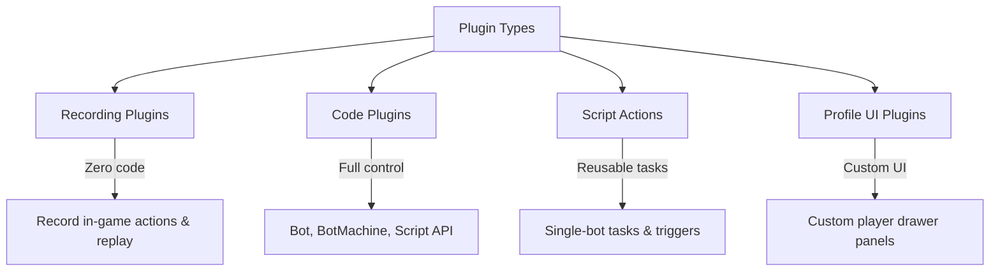

# Plugin development

Plugins extend JNbot with custom automation, game logic, triggers, and user interfaces. Whether you want to record a macro once or write advanced TypeScript bot machines, JNbot provides full scripting capabilities.



---

## Types of plugins

| Type | Language | Best for | Documentation |
| --- | --- | --- | --- |
| **Code Plugin** | JavaScript / TypeScript | Multi-alt bot runners, state machines, timers, custom server logic | [Bot API](./code-based/bot.md) & [Script API](./code-based/script.md) |
| **Script Action** | JavaScript / TypeScript | Reusable functions executed on an already connected bot or via triggers | [Actions](./code-based/actions.md) |
| **Profile UI Plugin** | JavaScript / TypeScript | Custom player drawer cards, ranks, KPI statistics, and API integrations | [Profile UI](./profile-ui.md) |
| **Recording** | Recorded Packets | Quick automations performed once and replayed directly | [Recordings](./recordings.md) |

---

## Creating your first plugin

1. Open **Plugins** in the JNbot desktop app.
2. Select **Create**.

   

3. Enter a name and description so you can recognize the plugin later.
4. Choose **JavaScript** or **TypeScript**.
5. Choose **Plugin** for a full script that manages its own bots. Choose **Action** for a short script that runs on a bot that is already online.
6. Select **Create** to open the editor. For a recorded task, choose **Recording** from the language menu instead. See [Record and replay a task](./recordings.md).

---

## Write a plugin with an AI assistant

In the plugin editor, open **AI help** and select **Copy AI context**. Paste it
into your assistant along with the task you want the plugin to perform. The
context points to the [JNbot API reference](https://jnbot.netlify.app/llm-all.txt).

Describe which alts or gamemodes to use and which values should be editable in
plugin settings. Paste the generated code into the editor and review it before
running it.

To let an assistant save and update plugins directly in JNbot, connect it
through [MCP](../mcp.md#create-and-update-plugins).

---

## Quickstart: Bot script

Here is a minimal plugin that joins an alt to a server gamemode and sends a chat message:

```js
const { Bot } = require("JNbot");

async function main() {
  const bot = await Bot.join(
    { username: "AltName" },
    {
      login: true,
      gamemode: "skyblockdream",
    }
  );

  await bot.chat("Hello from JNbot plugin!");
}

main();
```

---

## Quickstart: Multi-alt automation

To automate actions across multiple accounts with built-in controls (pause, skip, restart) and progress tracking, use `script.forEachBot`:

```js
const { script } = require("JNbot");

async function main() {
  const alts = script.getAlts();

  for await (const bot of script.forEachBot(alts, script.settings)) {
    console.log(`Running on ${bot.username}...`);
    await bot.chat("/kit daily");
    await bot.waitForTicks(20);
  }
}

main();
```

---

## Plugin development roadmap

Explore the dedicated guides to learn more about each part of the plugin system:

- **[Bot API](./code-based/bot.md)**: Connect, navigate gamemodes, interact with inventory windows, trade items, and pathfind.
- **[Script API](./code-based/script.md)**: Host app integration, notifications, dialogs, progress bars, reminders, and `BotMachine`.
- **[Local AI](./code-based/local-ai.md)**: Choose and run tools from text, extract structured data, create embeddings, and use custom models.
- **[Script Actions](./code-based/actions.md)**: Write modular actions and hook into triggers or dashboard buttons.
- **[Built-in action option IDs](./code-based/action-options.md)**: Add standard alt filters and run settings to an action's plugin options.
- **[Profile UI Plugins](./profile-ui.md)**: Build rich player drawer panels with live stats and badges.
