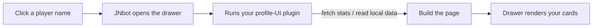

# Profile UI plugins

The **player drawer** is the panel that slides in when you click a player name
anywhere in JNbot — in chat, the player list, or a recording. What that drawer
shows is fully under your control: a **profile-UI plugin** decides which cards
appear, what's in them, and where the data comes from.



A profile-UI plugin is one **JavaScript or TypeScript** file that exports a
`main(args)` function. Every time a drawer opens, JNbot calls `main`, hands it
some read-only data about the player, and renders whatever you return.

You attach a profile-UI plugin to a server in **step 6 of the
[profile wizard](../profiles/wizard.md)**. If a server has no profile-UI plugin, JNbot
falls back to a built-in minimal layout.

:::tip Live preview
While editing, the wizard and the code editor both show a **live preview** of
the drawer for a real alt (pick which one from the dropdown). You don't have to
join a server to see your changes.
:::

---

## The `main` function

```js
async function main(args) {
  const p = new ProfileBuilder().player({ username: args.username });

  p.identity('left')
    .badge('Verified', 'emerald')
    .count('level', 42);

  return p.build();
}
```

- `main` may be **async** — `await` your `fetch` calls freely.
- Return the result of `new ProfileBuilder()....build()` (or a plain object of
  the same shape).
- The page is **validated before it renders**: unknown fields, malformed
  values, and over-long lists are dropped silently, so a small mistake never
  breaks the drawer.

---

## What you get: `args`

`main` receives a single read-only `args` object. Everything in it is a
snapshot — you can read it, but changes don't affect JNbot.

| Field           | Description                                                                                  |
| --------------- | -------------------------------------------------------------------------------------------- |
| `server`        | The active server id (e.g. `"jartexnetwork"`).                                                |
| `username`      | The player being looked up. **May not be one of your alts.**                                 |
| `alt`           | The matching alt (`username`, `premium`, `UID`, `email`) when `username` is yours, else `null`. |
| `serverAltInfo` | Per-server data for the alt: configured `ranks` and `gkits` by gamemode. Passwords are never exposed. `null` if not yours. |
| `stats`         | Local stats for the alt: `joinCount`, `lastJoined`, `playTime`, `createdOn`. `null` if not yours. |
| `profile`       | The server's profile metadata + per-gamemode rank/gkit catalog (prices & colors).            |
| `fetch`         | A restricted fetch you can use to pull data from an external API (see below).                |

:::note
`alt`, `serverAltInfo`, and `stats` are only populated when the player is one of
**your** alts. For anyone else (e.g. a stranger in chat) they're `null` — always
guard against that before reading them.
:::

### Fetching external data

`args.fetch` lets you call a public stats API. It's deliberately limited:

- Only `http`/`https` URLs.
- Response body capped at **1 MiB**.
- **6-second** timeout per request.

```js
const res = await args.fetch(
  'https://stats.example.net/api/profile/' + encodeURIComponent(args.username),
);
// res = { status, ok, text, json }
const data = res.ok ? res.json : {};
```

It resolves to `{ status, ok, text, json }`. `json` is auto-parsed when the
response is `application/json`, otherwise `null` — use `text` for anything else.

:::tip
Fetch each gamemode/endpoint in parallel with `Promise.all` and add a
`.catch(() => null)` per request, so one slow or failing endpoint doesn't stall
the whole drawer. The whole action shares a single time budget (see
[Limits](#limits)).
:::

---

## Building the page

Start with a `ProfileBuilder`, set the header with `.player(...)`, add one or
more **sections**, and finish with `.build()`.

```js
const p = new ProfileBuilder().player({
  username: args.username,
  displayRank: 'Warrior',
  skinUrl: 'https://crafthead.net/armor/body/' + encodeURIComponent(args.username),
});
```

### The player header

`.player(data)` sets the big header. Fields:

| Field         | Description                                                       |
| ------------- | ----------------------------------------------------------------- |
| `username`    | **Required.** The in-game name.                                   |
| `skinUrl`     | Override the body skin image. Defaults to a crafthead.net render. |
| `displayName` | Override the big name. Defaults to `username`.                    |
| `displayRank` | A highlighted rank pill shown before the name.                    |

### Sections

Each section builder is created from the `ProfileBuilder` and returns itself, so
calls chain. Every section takes an optional **column** — `'left'` or `'right'`
(default `'left'`) — that controls which side of the two-column drawer it lands
in.

| Builder              | Renders                                                  |
| -------------------- | ------------------------------------------------------- |
| `.identity(column)`  | Badges and headline count tiles under the player.       |
| `.kpis(column)`      | A strip of big KPI cards (a label + value each).         |
| `.stats(column)`     | A multi-gamemode stats card with a gamemode selector.    |
| `.ranks(column)`     | A grid of rank pills.                                    |
| `.gkits(column)`     | Gkit tags grouped by gamemode.                           |
| `.userList(title, column)` | A list of players (friends/clan) — each row opens that player's drawer. |

#### Identity

```js
p.identity('left')
  .badge('Email verified', 'emerald')      // (label, tone?, icon?)
  .badge('Discord linked', 'sky', 'discord')
  .count('level', 42)                       // (label, value)
  .count('friends', 18);
```

#### KPI strip

```js
p.kpis('right')
  .item('account worth', '€ 295.00', { icon: 'money', tone: 'amber' })
  .item('play time', '12h 30m', { icon: 'clock', tone: 'cyan' });
```

`item(label, value, opts?)` — `opts.icon` is one of `money`, `hash`, `clock`,
`star`, `trophy`, `bolt`; `opts.tone` is a [tone](#tones).

#### Stats

Add a gamemode tile, then attach its stat rows. Rows only appear when that tile
is the selected one.

```js
const s = p.stats('right');
s.gamemode('kitpvp', 'KitPvP', { icon: '🗡️', accent: '#f0a23b' })
  .add('Kills', '12,847', { rank: '#142', delta: '+318' })
  .add('Deaths', '3,201');
s.gamemode('bedwars', 'BedWars', { icon: '🛏️' })
  .add('Wins', '540');
s.selected('kitpvp'); // which tile is active by default
```

`.gamemode(id, label, opts?)` returns a sub-builder whose `.add(label, value,
opts?)` writes rows for that gamemode (`opts` may include a `rank` and a
`delta`). `opts` on the gamemode itself takes an emoji `icon` and a hex
`accent`.

#### Ranks

```js
p.ranks('right')
  .add('Warrior', 'KitPvP', 'amber', { emphasis: 'high' })
  .add('Member', 'Prison', 'slate', { emphasis: 'low' });
```

`.add(name, server?, tone?, opts?)` — `opts.emphasis` is `'high'` (filled) or
`'low'` (muted/outlined), handy for contrasting two classes of rank.

#### Gkits

```js
p.gkits('left')
  .group('KitPvP', ['Warrior', 'Knight'])
  .group('Factions', ['Immortal']);
```

#### User list

```js
const fl = p.userList('Friends · 18', 'left');
friends.forEach((f) => fl.add(f.username, { online: true, extra: 'lvl 12' }));
```

`.add(username, opts?)` — `opts.online` toggles the online dot, `opts.extra` is
secondary text on the right.

### Finishing

```js
return p.build();
```

---

## Tones

Several builders accept a `tone` for color. The available tones are:

`amber` · `emerald` · `rose` · `indigo` · `sky` · `purple` · `slate` · `red` ·
`cyan`

---

## Full example

```js
async function main(args) {
  const { username, stats, fetch } = args;

  // Pull a public profile API (guard the failure).
  const res = await fetch(
    'https://stats.example.net/api/profile/' + encodeURIComponent(username),
  ).catch(() => null);
  const data = res && res.json ? res.json : {};

  const p = new ProfileBuilder().player({
    username,
    displayRank: data.rank,
    skinUrl: 'https://crafthead.net/armor/body/' + encodeURIComponent(username),
  });

  // Identity badges + counts.
  const id = p.identity('left');
  if (data.email_verified) id.badge('Email verified', 'emerald');
  id.count('level', data.level ?? '—').count('friends', (data.friends || []).length);

  // KPIs — only show local stats when this is one of your alts.
  const kpi = p.kpis('right').item('network level', 'Lvl ' + (data.level ?? '—'), {
    icon: 'star',
    tone: 'amber',
  });
  if (stats) {
    kpi.item('times joined', String(stats.joinCount ?? 0), { icon: 'emerald', tone: 'emerald' });
  }

  // Stats card.
  const s = p.stats('right');
  s.gamemode('kitpvp', 'KitPvP', { icon: '🗡️' }).add('Kills', '12,847');
  s.selected('kitpvp');

  // Friends list (each row opens that player's drawer).
  (data.friends || []).forEach((f) => p.userList('Friends', 'left').add(f.username));

  return p.build();
}
```

---

## Limits

Your page is sanitized before it renders. The caps you're most likely to hit:

| What                       | Cap          |
| -------------------------- | ------------ |
| Action run time            | 5 seconds    |
| Sections per page          | 24           |
| KPI items                  | 8            |
| Ranks                      | 24           |
| Stat gamemodes / rows each | 16 / 12      |
| User-list rows             | 80           |
| Gkit groups / items each   | 16 / 24      |
| Badges                     | 8            |

Text is truncated to a safe length and anything that can't be coerced to the
expected type is dropped — so an over-long label or a stray field won't error,
it just won't show.

:::caution Sandbox
Profile-UI plugins run in a locked-down sandbox: no file system, no Node
modules, and the only way to reach the network is `args.fetch`. If your code
throws or times out, the drawer shows an error in the preview's log panel — keep
the console open while developing.
:::
