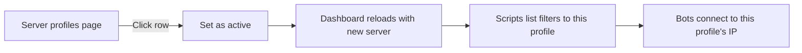

# Managing profiles

Day-to-day tasks once a profile exists.

## Switching the active profile

The active profile is the one bots, dashboards and scripts use. Click any
row on the Server profiles page to switch to it. The row highlights with
the profile's brand color and gets an **ACTIVE** tag.

## Editing

Only custom profiles can be edited.

1. Open **Server profiles**.
2. Find the row under **Custom**, click **Edit**.
3. The full wizard opens with every step already filled in and unlocked.
4. Jump straight to the step you want from the sidebar.
5. Click **Save changes** on the Review step.

To tweak a default profile, click **Clone to edit** — JNbot makes you a
custom copy with a new id.

## Duplicating

Use the `⋯` menu on a custom row → **Duplicate**. JNbot creates a copy with
`-copy` appended to the id; you can rename it during the wizard.

## Deleting

Use the `⋯` menu on a custom row → **Delete**. A confirmation dialog asks
to remove the profile from this device. Per-server settings (passwords,
ranks tracked on alts, stats) stay where they are — only the profile
definition is removed.

If the deleted profile was the active one, JNbot falls back to the first
available profile and reconnects the dashboard.

## Exporting & importing

Profiles are portable `.json` blobs.

- **Export** — `⋯` menu → **Export**. Saves a file you can share with
  someone or back up.
- **Import** — top of the page → **Import**. If the imported id collides
  with an existing profile, JNbot suffixes it (`my-profile-2`, etc.) so
  nothing is overwritten.

:::tip
Exports only contain the profile definition. Alt passwords and stats are
**not** included — sharing an export with a teammate is safe.
:::
